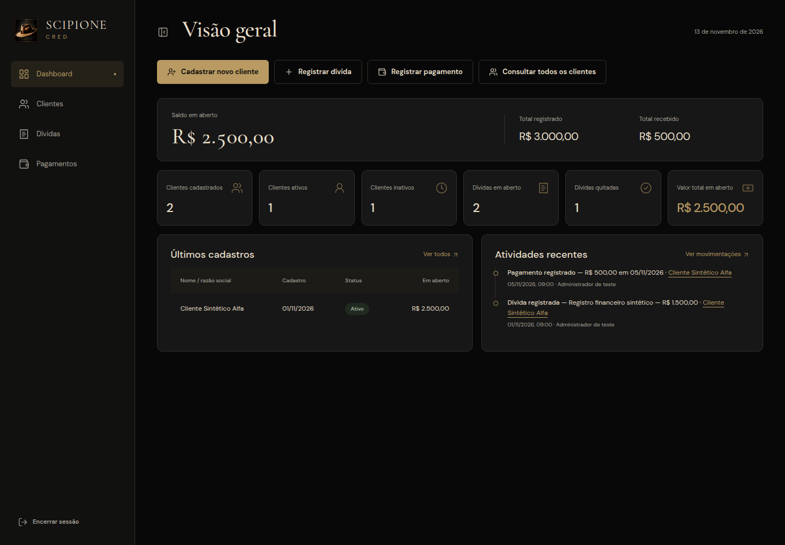
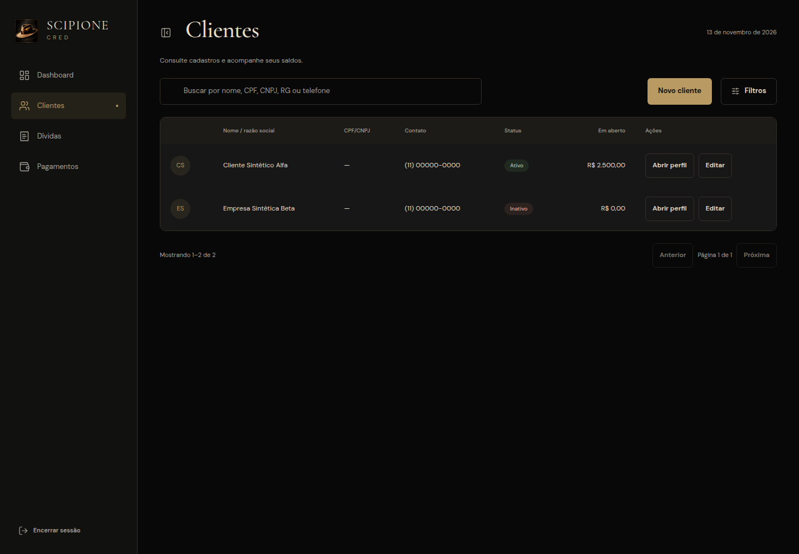
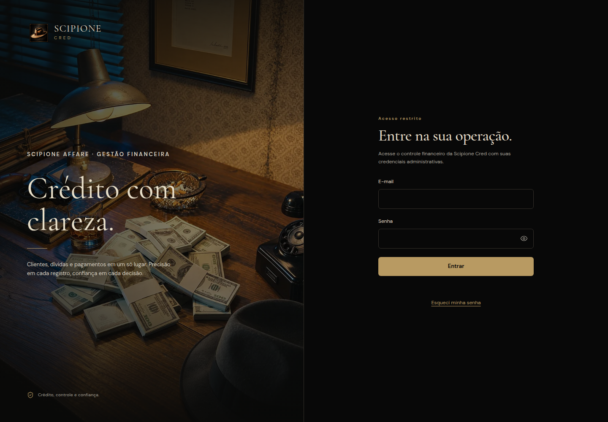
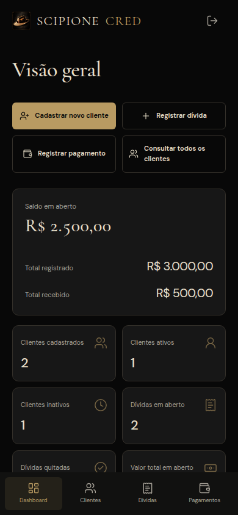
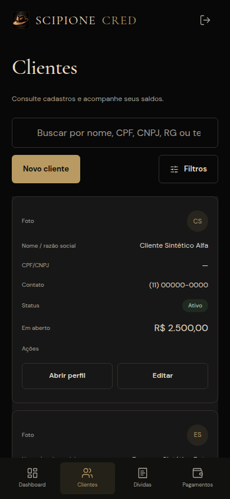

<div align="center">
  

  <h1>Scipione Cred</h1>

  <p><strong>Controle de crédito, dívidas e relacionamento com clientes</strong><br />
  Plataforma interna da Scipione Affare</p>

  <p>
    
    
    
    
    
    
  </p>

  <p>
    <a href="https://scipione-cred.vercel.app"><strong>Aplicação publicada</strong></a>
    &nbsp;·&nbsp;
    <a href="docs/arquitetura.md">Arquitetura</a>
    &nbsp;·&nbsp;
    <a href="docs/regras-de-negocio.md">Regras de negócio</a>
    &nbsp;·&nbsp;
    <a href="docs/modelagem-do-banco.md">Banco de dados</a>
  </p>
</div>

---

## Sobre o projeto

O **Scipione Cred** é o sistema interno da Scipione Affare para acompanhar quem deve, quanto deve e o que já foi pago. Ele reúne cadastro de clientes pessoa física e jurídica, registro de dívidas, pagamentos parciais e totais, controle documental e auditoria de cada movimentação — tudo em uma interface web responsiva, instalável e restrita à equipe administrativa.

O princípio que sustenta o sistema é simples: **o saldo nunca é digitado, é calculado**. Toda dívida nasce com um valor original, cada pagamento é um registro próprio e imutável, e o saldo em aberto é sempre a diferença entre os dois. Não existem juros, multas, encargos ou parcelamento: o que foi combinado é o que está registrado, e o que foi pago é o que está comprovado.

Isso resolve o problema central de um controle de crédito manual: planilhas divergem, pagamentos se perdem e não há rastro de quem alterou o quê. Aqui a integridade é garantida pelo banco de dados, não pela boa vontade de quem opera.

## Capturas de tela

<table>
  <tr>
    <td align="center" valign="top" width="33%">
      <br />
      <sub><b>Painel</b></sub>
    </td>
    <td align="center" valign="top" width="33%">
      <br />
      <sub><b>Clientes</b></sub>
    </td>
    <td align="center" valign="top" width="33%">
      <br />
      <sub><b>Acesso</b></sub>
    </td>
  </tr>
  <tr>
    <td align="center" valign="top" width="33%">
      <br />
      <sub>Painel no celular</sub>
    </td>
    <td align="center" valign="top" width="33%">
      <br />
      <sub>Clientes no celular</sub>
    </td>
    <td align="center" valign="top" width="33%">
      <br />
      <sub>Acesso no celular</sub>
    </td>
  </tr>
</table>

## Funcionalidades

**Acesso e segurança**
- Login por e-mail e senha com sessão gerenciada pelo Supabase Auth, sem cadastro público.
- Recuperação e redefinição de senha por e-mail, com política de senha forte.
- Rotas internas protegidas: sem sessão, a navegação retorna ao login.
- Perfil único de administrador, verificado no banco por função própria em todas as políticas.

**Clientes**
- Cadastro de pessoa física e jurídica, com validação de CPF/CNPJ por dígito verificador.
- Unicidade de documento garantida por índice no banco, não apenas na tela.
- Preenchimento automático de endereço por CEP (ViaCEP), sempre editável e sem bloquear o cadastro quando o serviço falha.
- Busca por nome, documento, RG e telefone, com filtros, ordenação e paginação executados no banco.
- Ativação e inativação com aviso do saldo em aberto; nada é apagado.

**Dívidas e pagamentos**
- Registro de dívidas com descrição, valor, data, vencimento opcional e observações.
- Pagamentos parciais ou totais, com comprovante opcional e proteção contra envio duplicado.
- Bloqueio de pagamento acima do saldo, inclusive em acessos simultâneos.
- Estorno com motivo obrigatório e histórico preservado — pagamento nunca é apagado.
- Exclusão definitiva apenas de dívida sem nenhum pagamento, com confirmação e registro em auditoria.

**Operação**
- Painel com indicadores reais: clientes cadastrados, ativos, inativos, dívidas em aberto e quitadas, valor total em aberto.
- Perfil do cliente com resumo financeiro, dívidas, pagamentos, documentos e linha do tempo.
- Upload de foto e documentos com validação de tipo, tamanho e conteúdo real do arquivo.
- Conversão automática de imagens para WebP e reotimização de PDFs antes de enviar ao Storage.
- Auditoria de todas as operações relevantes, em tabela que ninguém consegue alterar ou apagar.
- Instalável como aplicativo (PWA), sem armazenar dados financeiros em cache.

## Stack

| Camada | Tecnologia |
| --- | --- |
| Interface | JavaScript ES Modules, componentes web do Ionic Core, roteamento por hash |
| Build | Vite 8 (Node ≥ 20) |
| Dados e autenticação | Supabase: Auth, PostgreSQL, Row Level Security, Storage privado e RPCs |
| Estilo | CSS próprio com tokens de design, Cormorant Garamond e DM Sans servidas localmente |
| Ícones e animação | Lucide e GSAP |
| Arquivos | WebP via canvas, `pdf-lib` para PDFs |
| Testes | Vitest, jsdom, PostgreSQL local, PostgREST e Playwright |

## Arquitetura

O projeto **não tem servidor próprio**. A aplicação é uma SPA estática que conversa diretamente com o Supabase usando apenas a chave anônima pública. Toda a lógica que não pode ser burlada vive no PostgreSQL: constraints, triggers, views e funções transacionais.

```
┌──────────────────────────────┐        HTTPS         ┌──────────────────────────────────┐
│ Navegador / PWA              │ ───────────────────► │ Supabase                         │
│ Vite 8 · JS ESM · Ionic Core │  supabase-js (anon)  │  Auth (e-mail/senha)             │
│ GSAP · Lucide                │ ◄─────────────────── │  PostgreSQL + RLS + RPC          │
└──────────────┬───────────────┘                      │  Storage (buckets privados)      │
               │ fetch                                └──────────────────────────────────┘
               ▼
         ViaCEP (somente o CEP)
```

**Fluxo de uma operação**

1. A tela chama um módulo de `src/services/` — a única camada que fala com o Supabase.
2. Leituras usam `select` em tabelas e views protegidas por RLS.
3. Escritas financeiras chamam RPCs (`registrar_pagamento`, `estornar_pagamento`, `registrar_divida`, `alterar_valor_divida`, `alterar_status_devedor`, `excluir_divida`), que rodam em uma transação com bloqueio de linha (`SELECT … FOR UPDATE`).
4. Arquivos vão direto ao Storage, validados antes do envio; a leitura acontece por URL assinada de curta duração.
5. A auditoria é gravada por trigger no banco, independente da interface.

**Decisões estruturais**

- Rotas por hash (`#/devedores/:id`) para funcionar em hospedagem estática sem regras de reescrita; a interface chama essas entidades de **Clientes**, mas as rotas e o banco preservam o nome original.
- Validação em duas camadas: no cliente por usabilidade, no banco como fonte final da verdade.
- Operações privilegiadas (migrations, criação do administrador) ficam em `scripts/`, usando a service role apenas localmente, fora do bundle.

## Modelo de dados

**Tabelas** — `administradores`, `devedores`, `devedor_documentos`, `dividas`, `pagamentos`, `auditoria` e `configuracoes`.

**Views** — `vw_devedores_resumo` (dados do cliente com totais consolidados), `vw_dividas_saldo` (valor original, pago e saldo por dívida) e `vw_dashboard` (indicadores do painel). Todas com `security_invoker`, ou seja, respeitam as políticas de quem consulta.

**Funções transacionais** — registro de dívida, alteração de valor, registro de pagamento, estorno, alteração de status do cliente e exclusão de dívida sem pagamentos.

O esquema completo, com colunas, constraints e relacionamentos, está em [`docs/modelagem-do-banco.md`](docs/modelagem-do-banco.md).

## Regras financeiras

Estas são as invariantes que o banco garante, independentemente da interface:

| Regra | Comportamento |
| --- | --- |
| Saldo | `valor original − soma dos pagamentos válidos`; nunca negativo |
| Status da dívida | Derivado do saldo: `quitada` quando zero, `em_aberto` caso contrário — nunca editado à mão |
| Pagamento | Sempre vinculado a uma dívida, com valor maior que zero e menor ou igual ao saldo |
| Concorrência | A linha da dívida é bloqueada antes da validação, impedindo dois pagamentos simultâneos de estourarem o saldo |
| Idempotência | Cada envio carrega uma chave única, evitando pagamento duplicado por duplo clique |
| Correção | Pagamento não é apagado: é estornado com motivo, usuário e data, e deixa de contar no saldo |
| Exclusão | Apenas dívida sem nenhum pagamento pode ser apagada, com confirmação e registro em auditoria |
| Total em aberto | Soma todas as dívidas em aberto, inclusive de clientes inativos |
| Auditoria | Tabela append-only: triggers bloqueiam `UPDATE` e `DELETE` para todos |

As demais regras — de cadastro, arquivos e status — estão numeradas em [`docs/regras-de-negocio.md`](docs/regras-de-negocio.md).

## Segurança e privacidade

- **Autenticação obrigatória** em todas as rotas internas, com verificação de administrador ativo no banco.
- **RLS em todas as tabelas**, com função `is_admin()` aplicada em cada política; o papel `anon` não lê nem escreve nada.
- **Buckets privados** para fotos, documentos e comprovantes, com limite de tamanho e lista de MIME permitida no próprio bucket.
- **URLs assinadas** de curta duração para exibir arquivos; nenhum link público permanente.
- **Service role fora do bundle**: o app recusa iniciar se detectar chave privilegiada com prefixo `VITE_`.
- **Validação de arquivo** por extensão, MIME e assinatura binária, bloqueando arquivo renomeado.
- **PWA sem cache** de respostas da API, do Storage ou de qualquer dado pessoal.
- **Cabeçalhos de segurança** no build (CSP) e modelo de `_headers` para hospedagens estáticas.
- **Minimização de dados** e acesso restrito, alinhados à LGPD; as políticas de retenção ainda dependem de definição da Scipione Affare.

## Identidade visual

A interface segue uma direção editorial noir, com tipografia serifada nos títulos e sans-serif nos controles.

| Token | Valor | Uso |
| --- | --- | --- |
| `--preto` | `#080808` | Fundo da aplicação |
| `--grafite` | `#171717` | Superfícies e painéis |
| `--ouro` | `#B89A62` | Destaques, ações e marca |
| `--marfim` | `#E8DFC9` | Texto principal |
| `--bronze` | `#34302A` | Bordas e separadores |

Cormorant Garamond (títulos) e DM Sans (interface) são hospedadas localmente em `public/fonts`, com as licenças SIL OFL incluídas — nenhuma requisição é feita a serviços de tipografia. Os tokens ficam em `src/styles/tokens.css` e os componentes compartilhados em `src/styles/base.css`. A marca e os ícones do aplicativo são gerados a partir da arte original por `tools/marca.py`.

## Como rodar o projeto

### Pré-requisitos

- Node.js 20 ou superior
- Um projeto Supabase com Auth, banco e Storage
- `psql` apenas para a suíte SQL (opcional)

### Instalação

```bash
git clone https://github.com/JS171555/scipione-cred.git
cd scipione-cred
npm ci
cp .env.example .env
```

Preencha o `.env` com os dados públicos do projeto:

```env
VITE_SUPABASE_URL=https://<projeto>.supabase.co
VITE_SUPABASE_ANON_KEY=<chave anon/publishable>
VITE_APP_URL=http://localhost:5173
```

> A `service_role` nunca entra no `.env` da aplicação. Ela é usada apenas pelos scripts administrativos, digitada no terminal no momento da execução.

### Banco de dados

Aplique as migrations em `supabase/migrations/` com o Supabase CLI:

```bash
supabase link --project-ref <ref>
supabase db push
```

Ou execute os arquivos em ordem no SQL Editor do painel. Depois confirme que os três buckets estão privados. O passo a passo detalhado, incluindo Auth e SMTP, está em [`docs/supabase-setup.md`](docs/supabase-setup.md).

### Administrador inicial

```bash
npm run admin:criar
```

O script pede URL, service role, nome, e-mail e senha forte; recusa se já houver administrador ativo e desfaz o usuário caso o registro falhe.

### Desenvolvimento

```bash
npm run dev      # http://localhost:5173
npm run build    # gera dist/
npm run preview  # serve o build
```

## Scripts

| Comando | O que faz |
| --- | --- |
| `npm run dev` | Ambiente de desenvolvimento com recarregamento |
| `npm run build` | Build de produção em `dist/` |
| `npm run preview` | Serve o build localmente |
| `npm test` | Testes unitários e de tela (118 testes, 13 arquivos) |
| `npm run test:sql` | Migrations, RLS, integridade financeira e concorrência em PostgreSQL |
| `npm run test:integracao` | Serviços do frontend contra PostgREST e PostgreSQL reais |
| `npm run admin:criar` | Cria o administrador inicial |
| `npm run verificar:supabase` | Auditoria somente leitura da configuração remota |

## Testes

A estratégia é não depender de dados de produção: cada suíte sobe o próprio banco descartável ou intercepta os serviços dentro do navegador de teste.

| Suíte | Cobre | Requer |
| --- | --- | --- |
| `npm test` | Validadores, regras financeiras, formulários, perfil, dashboard, listas, paginação e proteção de rotas | Nada além do Node |
| `npm run test:sql` | Migrations, RLS, bloqueio de `anon`, CPF/CNPJ, saldo, quitação, estorno, imutabilidade da auditoria e dois pagamentos simultâneos | PostgreSQL local |
| `npm run test:integracao` | Serviços do frontend contra PostgREST com as migrations reais, incluindo Storage simulado | Binário do PostgREST |
| `tests/visual/run.mjs` | Layout em cinco larguras, estados de erro, upload, navegação e acessibilidade básica | Playwright e Chromium |
| `tests/visual/production.mjs` | Build sem configuração, manifest, ícones, service worker e ausência de cache | Playwright e Chromium |

O roteiro manual do que a automação não alcança — login real, e-mail de recuperação, expiração de URL assinada — está em [`docs/testes.md`](docs/testes.md).

## Estrutura

```text
scipione-cred/
├─ docs/                    documentação técnica e de negócio
│  └─ previews/             capturas usadas neste README
├─ public/                  manifest, ícones, marca, fontes e imagens
├─ scripts/                 criação de administrador e verificação do Supabase
├─ src/
│  ├─ components/           casca da aplicação, tabelas, diálogos, upload, estados
│  ├─ core/                 Supabase, configuração, router, erros, terminologia
│  ├─ domain/               regras puras de cliente, dívida e movimentação
│  ├─ modules/              uma tela por arquivo (login, dashboard, listas, formulários)
│  ├─ services/             única camada que fala com Supabase e ViaCEP
│  ├─ styles/               tokens de design e estilos compartilhados
│  ├─ utils/                CPF/CNPJ, dinheiro, datas, senha, arquivos e mídia
│  └─ main.js               bootstrap, rotas e registro do service worker
├─ supabase/migrations/     12 migrations SQL versionadas
├─ tests/                   unit, ui, sql, integration e visual
├─ tools/                   geração da marca e arte original
├─ index.html               entrada da aplicação
└─ vite.config.js           build, CSP e configuração de assets
```

## Documentação

| Documento | Conteúdo |
| --- | --- |
| [`docs/arquitetura.md`](docs/arquitetura.md) | Requisitos, arquitetura, módulos e mapa de segurança |
| [`docs/regras-de-negocio.md`](docs/regras-de-negocio.md) | Regras numeradas de acesso, cadastro, arquivos, dívidas e pagamentos |
| [`docs/modelagem-do-banco.md`](docs/modelagem-do-banco.md) | Tabelas, colunas, constraints, views e migrations |
| [`docs/decisoes.md`](docs/decisoes.md) | Decisões técnicas com justificativa e pendências |
| [`docs/supabase-setup.md`](docs/supabase-setup.md) | Configuração de Auth, banco, Storage e administrador |
| [`docs/testes.md`](docs/testes.md) | Cobertura automatizada e roteiro de validação manual |
| [`docs/hospedagem.md`](docs/hospedagem.md) | Publicação, cabeçalhos HTTP e limites da PWA |
| [`docs/ativos-visuais.md`](docs/ativos-visuais.md) | Origem e licença das fontes, marca e imagens |
| [`docs/relatorio-redesign.md`](docs/relatorio-redesign.md) | Registro da evolução da interface |

## Publicação

A aplicação é estática e publicada na Vercel em [scipione-cred.vercel.app](https://scipione-cred.vercel.app). O build gera `dist/` com CSP configurada e copia o modelo `public/_headers` para hospedagens que aceitam esse formato.

Em qualquer provedor, os cabeçalhos abaixo precisam ser enviados pelo servidor ou CDN, pois `frame-ancestors` não funciona por meta tag:

```
Content-Security-Policy: frame-ancestors 'none'
X-Frame-Options: DENY
X-Content-Type-Options: nosniff
Referrer-Policy: no-referrer
```

## Estado do projeto

- Versão **0.2.0**, em evolução ativa.
- Interface, fluxos financeiros, auditoria e PWA concluídos e cobertos por testes.
- Pendências de negócio: obrigatoriedade de CPF/CNPJ, limites finais de anexo, política de retenção de dados (LGPD), rotina de backup e domínio definitivo. O detalhamento está em [`docs/decisoes.md`](docs/decisoes.md).

## Licença

Código proprietário da **Scipione Affare**. O repositório é público para consulta técnica, mas não concede licença de uso, cópia, modificação ou redistribuição. Dados de clientes não fazem parte do repositório: toda a informação operacional vive no projeto Supabase da empresa.

---

<div align="center">
  <sub>Desenvolvido para a operação de crédito da Scipione Affare.</sub>
</div>
