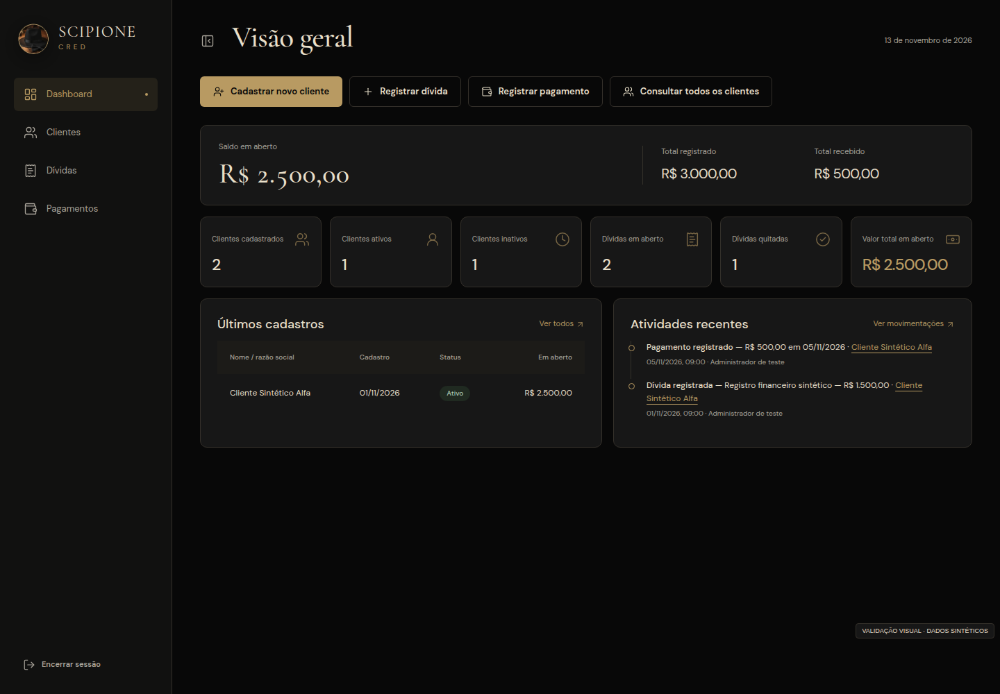
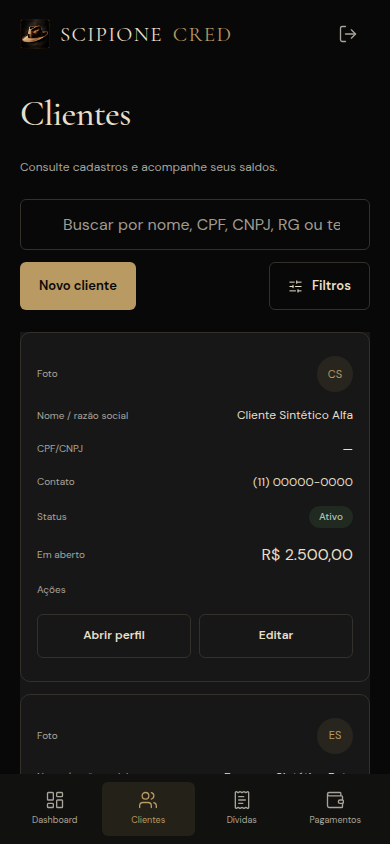

# Scipione Cred — relatório de implementação do redesign

**Data:** 12 de novembro de 2026

**Repositório:** JS171555/scipione-cred

**Base analisada:** `6ffe000` — Fix terminology observer mutation loop

**Entrega:** [Pull request #1](https://github.com/JS171555/scipione-cred/pull/1), branch `feat/redesign-ui-premium`, para revisão e integração; sem alteração direta de produção.

## 1. Resultado

O redesign foi implementado no código existente. Não é um wireframe, imagem conceitual ou aplicativo paralelo. A SPA mantém Vite 8, JavaScript ESM, Ionic Core, Supabase, Lucide e GSAP já presentes. Não houve alteração de `package.json` ou do lockfile, adição de framework, recriação de backend ou mudança de migrations/RLS.

A identidade utiliza preto `#080808`, grafite `#171717`, dourado `#B89A62`, marfim `#E8DFC9` e bronze `#34302A`. Cormorant Garamond e DM Sans são servidas localmente, com licenças SIL OFL incluídas. A interface exibe “Clientes”, conforme a evolução recente do repositório; entidades, serviços e rotas internas `/devedores` permanecem compatíveis.

## 2. Telas entregues

| Tela | Implementação |
|---|---|
| Login | Marca, hierarquia editorial, e-mail/senha, mostrar/ocultar senha, recuperação, validação e feedback de autenticação. |
| Recuperação de senha | Formulário consistente, carregamento e mensagem sem revelar a existência de uma conta. |
| Redefinição de senha | Política existente, confirmação, visibilidade, validação e proteção contra retorno de navegação antiga. |
| Configuração pendente | Estado seguro e legível quando a configuração Supabase não está disponível; não libera acesso administrativo. |
| Dashboard | Seis indicadores existentes, total registrado/recebido/saldo em aberto, últimos clientes, dívidas, pagamentos e timeline da operação. |
| Clientes | Busca, filtros cadastrais/financeiros, ordenação, paginação, foto privada/iniciais, documento, contato, saldo, perfil e edição. |
| Cadastro e edição | Seções PF/PJ, RG aplicável, contato, endereço, ViaCEP editável, observações, foto e documentos. Status continua seguindo os fluxos existentes. |
| Perfil individual | Foto, identificação e contato no cabeçalho, status/data, dados completos, totais, dívidas, pagamentos, estorno, documentos e histórico paginado. |
| Dívidas | Nova lista global com busca, situação, ordenação, paginação e ações existentes. |
| Seleção de cliente | Atalho global para nova dívida; consulta somente clientes ativos. |
| Registro/edição de dívida | Cliente relacionado, descrição, valor, registro, vencimento opcional e observações; resumo do valor antes de confirmar. |
| Pagamentos | Nova lista global, inclusive estornados, com busca, ordenação, paginação e comprovantes privados. |
| Seleção de dívida | Atalho global para registrar pagamento; consulta dívidas em aberto. |
| Registro de pagamento | Original/pago/saldo atual, valor novo e saldo após o lançamento, parcial ou quitação total, comprovante opcional e prevenção de duplicidade. |

A navegação continua por hash e preserva filtros e páginas na URL. Os novos atalhos selecionam a entidade correspondente antes de encaminhar aos formulários existentes.

## 3. Componentes e design system

Foram criados `auth-layout.js`, `icons.js`, `states.js`, `tabelas.js` e `upload.js`. O componente `pagina.js` foi evoluído para incluir marca, sidebar recolhível, cabeçalho, identificação administrativa, perfil e encerramento de sessão. `dialogos.js` mantém as confirmações existentes, com foco inicial e fechamento/cancelamento acessível.

Os tokens de `src/styles/tokens.css` centralizam cores, fontes, espaçamentos, bordas, raios, sombras e transições. `base.css` reúne os padrões compartilhados de botões, campos, selects, filtros, cards, badges, tabelas, paginação, menus, alertas, uploads e estados. Não foram introduzidos componentes sem função nem configurações administrativas que não existem no backend.

Os ícones usam imports específicos de Lucide. As animações são discretas e respeitam `prefers-reduced-motion`; não há gráficos fictícios, efeitos neon ou dependência adicional de animação.

## 4. Melhorias de UX e responsividade

No desktop, a navegação lateral pode ser recolhida. No mobile, há cabeçalho compacto e navegação inferior própria. As tabelas passam a cards com rótulos por célula; a adaptação atende também tabelas inseridas após consultas assíncronas. Os formulários passam para uma coluna e as ações se reorganizam com alvos de toque confortáveis.

Há estados de carregamento, vazio, busca sem resultados, erro e nova tentativa. Os erros de formulário são associados aos campos e direcionam o foco. Pagamentos mostram a posição antes e depois, com ação de quitação total. Operações preservam os avisos de sucesso e a confirmação das ações destrutivas.

O upload apresenta formato, tamanho, seleção/prévia, remoção, validação e estado de envio indeterminado. Não exibe percentual inventado. A validação mais recente é aguardada antes de salvar; arquivos rejeitados não são descartados silenciosamente. As URLs de prévia são revogadas ao substituir, remover ou sair da tela, não antes de terminar seu uso.

A navegação cancela renderizações antigas por `AbortSignal`. Consultas atrasadas não atualizam telas desconectadas nem a rota atual após encerramento da sessão. O atalho “Pular para o conteúdo” foca a página sem acionar o roteador por hash.

Os contrastes medidos sobre os fundos principais ficam acima de 4,5:1 para marfim, dourado, texto secundário e cores semânticas utilizadas. Essa verificação pontual e os testes de teclado não equivalem a uma certificação formal completa de acessibilidade.

## 5. Funcionalidades e segurança preservadas

Mantidos: autenticação administrativa, recuperação de senha, RLS, buckets privados, URLs assinadas curtas, validação de arquivos por regras existentes, cadastro PF/PJ, busca, ViaCEP, múltiplas dívidas, pagamento parcial/total, estorno auditado, histórico e idempotência. Nenhum histórico financeiro foi removido em ambiente real.

CPF/CNPJ permanece opcional até a decisão comercial. Vencimento e comprovante são opcionais. Status financeiro e saldo continuam derivados das dívidas e pagamentos válidos; não foi introduzido seletor manual que contorne o banco.

Não foram implementados juros, multas, encargos, parcelamento automático, integração bancária ou cobranças automáticas. Os serviços de autenticação, arquivos, documentos e o domínio financeiro existente não foram substituídos.

As novas leituras usam as views existentes e a mesma autorização Supabase. A consolidação financeira percorre todas as páginas ordenadas e soma centavos inteiros. As buscas globais não tratam a primeira página de 1.000 correspondências como total: há paginação completa, deduplicação e consultas por IDs em lotes de até 200. Termos com vírgulas e parênteses não são interpolados na gramática de filtros `.or()`.

A tradução de terminologia foi restringida a copy estática marcada; nomes, descrições, observações e registros de auditoria não são alterados visualmente por substituição global de palavras.

A PWA usa manifest e ícones próprios, com service worker sem interceptação de rede ou cache offline. A validação do build confirmou zero Cache Storage e zero dados em localStorage no estado sem configuração. A preferência de sidebar é o único novo dado de UI persistido; a sessão Supabase continua sob o mecanismo existente.

## 6. Testes realizados

| Validação | Resultado |
|---|---|
| `npm ci` | Instalação a partir do lockfile existente. |
| `npm test` | **96 testes em 11 arquivos, todos passando.** Os 79 testes originais permanecem sem alterações; foram adicionados 17 casos. |
| `npm run test:sql` / executor SQL local | Todas as migrations e regras SQL passaram em PostgreSQL 16 isolado. Inclui RLS, validações, idempotência, saldo e concorrência. Dois pagamentos concorrentes resultaram em um válido, um rejeitado por saldo e saldo final correto. |
| `npm run test:integracao` com PostgREST local | **25 testes em 2 arquivos, todos passando:** 21 originais e 4 novos. Supabase-js consulta PostgreSQL/PostgREST reais locais; Storage é simulado em memória, conforme o executor existente. |
| Chromium headless, 14 telas × 5 larguras | **70 verificações de layout passaram** em 320, 390, 768, 1024 e 1440 px, sem overflow horizontal no documento. |
| Interações visuais | Sidebar recolhível; atalho de teclado; seleção de cliente/dívida; navegação por hash; quitação e excesso de pagamento; validação de cadastro; PF/PJ/RG; busca sem resultados; erro/retry em clientes e pagamentos; visibilidade de senha e login sintético. |
| Console do teste visual | Zero erros de execução capturados. |
| Build servido localmente | Configuração pendente bloqueia acesso; manifest, ícones, fontes e service worker retornam HTTP 200; service worker ativo sem cache ou dados pessoais. Console sem erros após correção da CSP. |
| `npm run build` | Concluído com sucesso. |
| `node --check` e `git diff --check` | Sem falhas de sintaxe ou whitespace. |

Os testes visuais interceptam os serviços somente no navegador do teste. Não há modo demo, dados fictícios ou bypass de autenticação no bundle do aplicativo. Nenhum dado de cliente real foi usado. A integração foi validada em ambiente local descartável, **não no projeto Supabase remoto**.

## 7. Problemas encontrados e resolvidos

Foram corrigidos: ausência de navegação financeira global; falta de visão financeira consolidada; tabelas inadequadas no mobile; inconsistência dos fluxos públicos; falta de feedback de uploads; seleção financeira que retirava o hash da URL; botão de retry de pagamentos que não respondia; buscas truncadas em volumes maiores; caracteres especiais interpolados em filtros; renderizações antigas durante navegação; validação de anexo ainda em andamento no submit; concorrência entre seleções de arquivo; tradução global que alterava dados apresentados; ícones PWA ausentes; e `frame-ancestors` ineficaz em meta CSP.

A proteção `frame-ancestors` foi preparada como cabeçalho HTTP em `public/_headers`, com instruções para o provedor de hospedagem. A CSP de scripts/conexões permanece no build, e a tipografia não exige conexões externas.

Os novos testes de integração receberam teardown restrito ao banco descartável `scipione_it`, evitando interferência nas expectativas dos testes originais.

## 8. Pendências para disponibilização em produção

1. Preencher/verificar a configuração pública do **projeto Supabase existente** e a origem do aplicativo. Não usar service_role/secret em variáveis VITE_. Não havia essa configuração disponível nesta sessão.
2. Validar no projeto remoto o administrador, SMTP, redirecionamentos da recuperação, limites finais de anexos e políticas dos buckets. Nenhuma escrita remota foi realizada.
3. Definir ou confirmar domínio/hospedagem e aplicar os cabeçalhos HTTP documentados. `_headers` só é aplicado por provedores que aceitam esse formato; `vite preview` não comprova os cabeçalhos do domínio final.
4. Validar a instalação e os fluxos de recuperação em aparelhos físicos Android/iOS e no navegador final. A evidência desta entrega é de Chromium em larguras mobile/tablet/desktop, não de testes físicos Safari/iOS.
5. Confirmar as decisões preexistentes de CPF/CNPJ, LGPD, limites, backup e retenção. A definição comercial não foi alterada pelo redesign.
6. O comportamento preexistente de arquivos órfãos em falhas entre upload e escrita vinculante continua exigindo reconciliação pelo responsável pelo Supabase. As políticas privadas não foram contornadas para adicionar exclusão indevida de comprovantes/documentos.
7. Buscas globais muito amplas fazem mais leituras paginadas para garantir completude sem recriar backend. Para volumes excepcionalmente grandes, avaliar futuramente uma RPC paginada no projeto existente, mediante autorização para alteração de backend.

## 9. Capturas de validação

As imagens abaixo mostram exclusivamente dados sintéticos e estão rotuladas como validação visual.

### Dashboard desktop

### Login mobile

### Clientes mobile

## 10. Arquivos modificados e adicionados

A lista completa é apresentada a seguir. As migrations, o modelo financeiro, os serviços de autenticação e os testes originais não foram modificados.

### Modificados

- `index.html`
- `src/components/dialogos.js`
- `src/components/pagina.js`
- `src/core/router.js`
- `src/core/terminologia.js`
- `src/main.js`
- `src/modules/config-pendente.js`
- `src/modules/dashboard.js`
- `src/modules/devedor-detalhe.js`
- `src/modules/devedor-form.js`
- `src/modules/devedores-lista.js`
- `src/modules/divida-form.js`
- `src/modules/login.js`
- `src/modules/pagamento-form.js`
- `src/modules/recuperar.js`
- `src/modules/redefinir.js`
- `src/services/dashboard.js`
- `src/services/devedores.js`
- `src/services/dividas.js`
- `src/services/pagamentos.js`
- `src/styles/base.css`
- `vite.config.js`

### Adicionados

- `.env.example`
- `.gitignore`
- `TODO.md`
- `docs/ativos-visuais.md`
- `docs/hospedagem.md`
- `docs/previews/clientes-mobile.png`
- `docs/previews/dashboard-desktop.png`
- `docs/previews/login-mobile.png`
- `docs/relatorio-redesign.md`
- `plan.md`
- `public/_headers`
- `public/fonts/cormorant-garamond-0.woff2`
- `public/fonts/cormorant-garamond-1.woff2`
- `public/fonts/cormorant-garamond-2.woff2`
- `public/fonts/cormorant-garamond-3.woff2`
- `public/fonts/cormorant-garamond-OFL.txt`
- `public/fonts/cormorant-garamond.css`
- `public/fonts/dm-sans-0.woff2`
- `public/fonts/dm-sans-1.woff2`
- `public/fonts/dm-sans-2.woff2`
- `public/fonts/dm-sans-3.woff2`
- `public/fonts/dm-sans-OFL.txt`
- `public/fonts/dm-sans.css`
- `public/icons/icon-192.png`
- `public/icons/icon-512.png`
- `public/manifest.webmanifest`
- `public/manus-routes.json`
- `public/sw.js`
- `src/components/auth-layout.js`
- `src/components/icons.js`
- `src/components/states.js`
- `src/components/tabelas.js`
- `src/components/upload.js`
- `src/modules/dividas-lista.js`
- `src/modules/pagamentos-lista.js`
- `src/modules/selecionar-registro.js`
- `src/styles/tokens.css`
- `tests/integration/redesign.test.js`
- `tests/ui/form-redesign.test.js`
- `tests/ui/list-redesign.test.js`
- `tests/ui/navigation-redesign.test.js`
- `tests/unit/list-services.test.js`
- `tests/visual/production.mjs`
- `tests/visual/run.mjs`
